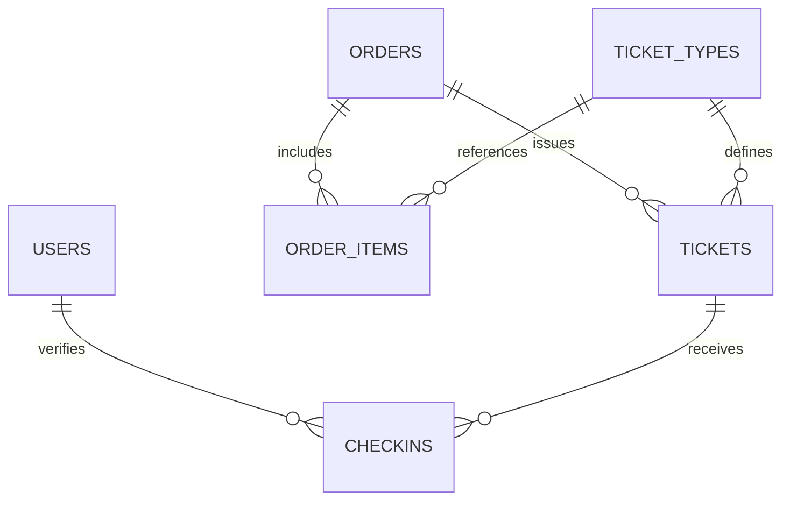

# ระบบและ API สำหรับผู้พัฒนาต่อ

## สถาปัตยกรรม

- Frontend: HTML + CSS + JavaScript; Responsive CSS ไม่ต้องติดตั้ง frontend packages
- Backend: Node.js 22+ `http.createServer()` ใน `server.js` (เวอร์ชันเริ่มต้น **ไม่ใช่ Express**)
- Database: Node built-in `node:sqlite` (`DatabaseSync`) ใน `src/db.js`
- UI Rendering: `src/pages.js` (server-rendered HTML และ escaping)
- QR: `src/qr.js` (version 3-L byte encoding, 26-character token, SVG)
- Sessions: in-memory random bearer cookie; separate admin/staff roles
- Check-in: only active tickets for current date in `Asia/Bangkok`, atomically marked used

## Data model



- `users(username, password_hash, role)`: `admin` / `staff`
- `ticket_types(id, name, description, price, active, sort_order)`
- `orders(id, customer_name, customer_email, visit_date, status, total, created_at, paid_at)`
- `order_items(order_id, ticket_type_id, quantity, unit_price)`
- `tickets(id, order_id, ticket_type_id, qr_token, visit_date, status, checked_in_at, checked_in_by)`
- `checkins(ticket_id, checked_in_by, checked_in_at)`

## Routes

| Method | Endpoint | Purpose |
|---|---|---|
| `GET` | `/` | Landing + booking |
| `POST` | `/api/orders` | Create pending order |
| `GET` | `/checkout/:orderId` | Order details |
| `POST` | `/api/orders/:orderId/simulate-pay` | **Demo only:** issue tickets after simulated payment |
| `GET` | `/tickets/:orderId` | View QR tickets |
| `GET` | `/qr/:qrToken.svg` | Download scannable SVG |
| `GET` | `/lookup` | Find paid order with ID |
| `GET` | `/login` | Staff/admin login |
| `POST` | `/api/login` | Create role-specific session |
| `GET` | `/staff` | Staff scanner (role-protected) |
| `POST` | `/api/scan` | Verify + consume ticket (role-protected, CSRF) |
| `GET` | `/admin` | Dashboard (admin only) |
| `POST` | `/api/admin/types/:id` | Update example ticket price/active (admin only, CSRF) |
| `POST` | `/api/logout` | Logout (role-protected, CSRF) |

`POST` endpoints accept JSON. Public `/api/orders` example:

```json
{
  "customerName": "ผู้ทดสอบ",
  "customerEmail": "example@email.com",
  "ticketTypeId": "garden",
  "quantity": 2,
  "visitDate": "2026-11-03"
}
```

### QR design

QR contains an **opaque random 26-character token** starting with `DT`. It contains no customer identity or email. QR must be checked by server; do not accept it just because it visually resembles a valid ticket. For the demo, check-in transaction records the exact ticket and staff actor; repeat check-in returns `409`.

### Payment gateway implementation note

`/simulate-pay` is an explicit testing shortcut. **Never enable it for real ticket sales.** For real payments use payment intents from the gateway, verified webhook signatures, backend-side amount/order checks, replay protection, idempotent order transitions, and security-reviewed production deployment.
